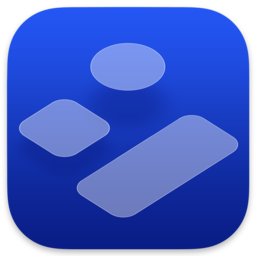
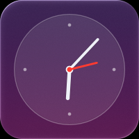
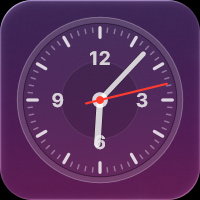
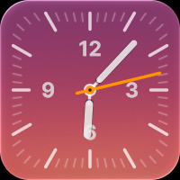
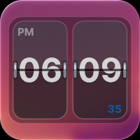
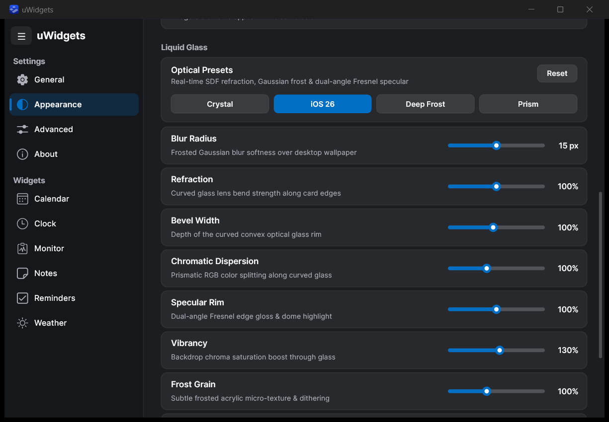
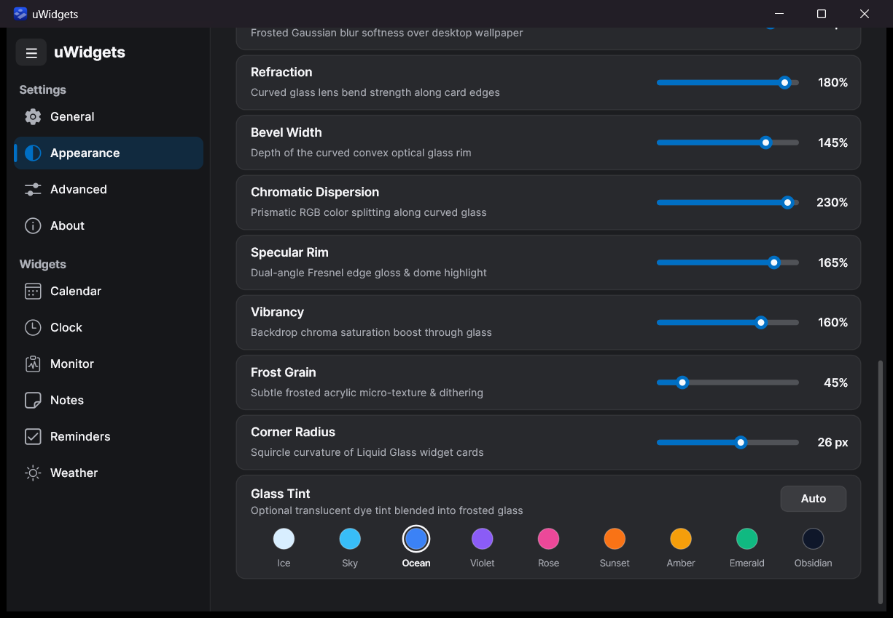
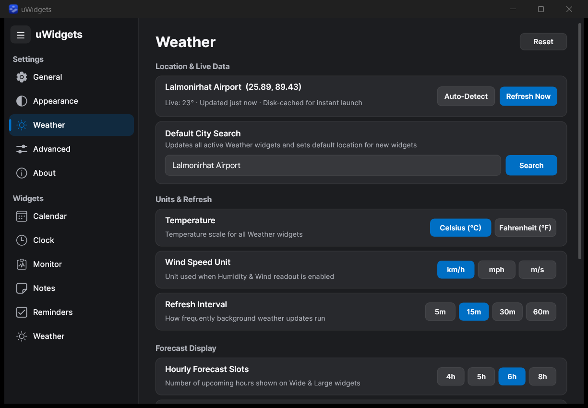
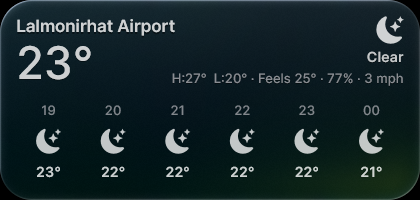

<div align="center">



# uWidgets — Rust Edition

### Ultra-Lightweight, Real-Time Liquid Glass Desktop Widgets for Windows 10 & 11

[](https://www.rust-lang.org/)
[](#quick-start)
[](#architecture)
[](#performance-benchmarks)
[](#performance-benchmarks)
[](#parity-verification)

**A ground-up native Win32 + Direct2D + DirectComposition rewrite of [uWidgets](https://github.com/creewick/uWidgets) in pure Rust** — featuring an Apple iOS 26–inspired **SDF Liquid Glass optical engine**, **5× lower RAM usage**, **18× smaller disk footprint**, **zero .NET/Avalonia runtime overhead**, and **instant disk-cached Weather**.

<p>
  <a href="#quick-start"><strong>🚀 Get Started</strong></a> ·
  <a href="#liquid-glass-optical-engine"><strong>✨ Liquid Glass</strong></a> ·
  <a href="#widget-catalog"><strong>🧩 16 Widgets</strong></a> ·
  <a href="#weather-customization"><strong>🌤️ Weather Tab</strong></a> ·
  <a href="#performance-benchmarks"><strong>⚡ Benchmarks</strong></a> ·
  <a href="#contributing"><strong>🤝 Contribute</strong></a>
</p>

</div>

---

## Why uWidgets (Rust Edition)?

Desktop widgets stay open all day — they shouldn't eat 140 MB of RAM or drag a 60 MB managed runtime along for the ride. **uWidgets-rs** compiles down to a **single ~3.4 MB native Windows executable** with an embedded multi-resolution app icon, **0% idle CPU**, and real-time wallpaper-aligned **Liquid Glass** optics.

### Performance Benchmarks

Measured live on Windows 11 (125% DPI) running 4 active desktop widgets (`Calendar / Date`, `Calendar / Month`, `Clock / Analog III`, `Weather / Forecast`):

| Metric | Original C# / .NET 8 (Avalonia) | **uWidgets-rs (Pure Rust)** | Improvement |
| :--- | :---: | :---: | :---: |
| **Private Memory (RAM)** | 135.7 MB | **~24.9 MB** | **5.4× lighter** |
| **On-Disk Footprint** | 61.27 MB (multi-DLL) | **3.44 MB (single `.exe`)** | **17.8× smaller** |
| **Cold Startup** | ~900+ ms | **~218 ms** | **4× faster** |
| **Weather Startup (Cached)** | Network-blocked | **< 5 ms (instant)** | **Zero "Loading…" flash** |
| **Runtime Dependencies** | .NET 8 + Avalonia + Skia | **None (Native Win32)** | **100% standalone** |
| **Idle CPU Usage** | ~0.5–1.5% | **0.0%** (adaptive timers) | **Battery-friendly** |

---

## Visual Showcase

### Liquid Glass Clock Collection
Four bespoke Liquid Glass clock faces — from minimalist frosted optical lenses to sculpted mechanical split-flap tiles:

<div align="center">
<table>
  <tr>
    <td align="center" width="25%">
      <br/>
      <strong>Analog I</strong><br/><sub>Minimal frosted lens & red sweep</sub>
    </td>
    <td align="center" width="25%">
      <br/>
      <strong>Analog II</strong><br/><sub>Sculpted bezel, recessed well & 60 ticks</sub>
    </td>
    <td align="center" width="25%">
      <br/>
      <strong>Analog III</strong><br/><sub>Squircle contour & Watch orange hand</sub>
    </td>
    <td align="center" width="25%">
      <br/>
      <strong>Flip Clock</strong><br/><sub>Split-flap Liquid Glass with side hinges</sub>
    </td>
  </tr>
</table>
</div>

### Live Liquid Glass Customization (`Settings → Appearance`)
Tune every optical parameter live with instant real-time feedback across all desktop widgets:

<div align="center">
<table>
  <tr>
    <td width="50%">
      
      <p align="center"><sub><strong>Optical Presets & Live Sliders</strong> — Crystal, iOS 26, Deep Frost & Prism</sub></p>
    </td>
    <td width="50%">
      
      <p align="center"><sub><strong>Corner Radius & 9 Glass Dye Tints</strong> — Ice, Sky, Ocean, Violet, Rose, Sunset, Amber, Emerald, Obsidian</sub></p>
    </td>
  </tr>
</table>
</div>

### Dedicated Weather Tab & Instant Forecast Widget (`Settings → Weather`)
Search cities worldwide, auto-detect your location in one click, and toggle rich live metrics directly on your Liquid Glass Forecast card:

<div align="center">
<table>
  <tr>
    <td width="58%">
      
      <p align="center"><sub><strong>Weather Tab</strong> — Live status, Auto-Detect, City Search, Units, Refresh & Display toggles</sub></p>
    </td>
    <td width="42%" valign="middle" align="center">
      
      <p align="center"><sub><strong>Live Forecast Card</strong> — Instant cached startup + Feels Like, Humidity & Wind</sub></p>
    </td>
  </tr>
</table>
</div>

---

## Liquid Glass Optical Engine

Inspired by **Apple iOS 26 / macOS Tahoe**, **Kyant0's AndroidLiquidGlass**, and **liquidGL**, our native DirectComposition shader pipeline (`rust/app/src/platform/liquid_glass.rs`) renders physically grounded frosted glass directly aligned to your Windows desktop wallpaper:

- **Exact Rounded-Box Signed Distance Field (SDF)** with sub-pixel anti-aliasing and analytic outward surface normals.
- **3-Pass Separable Gaussian Frost Blur** (`0` – `30 px`) cached in memory — dragging the Blur slider re-blurs in ~4 ms with zero disk I/O.
- **Curved Bevel Lens Refraction (`0%` – `200%`) & Bevel Width (`30%` – `180%`)** bending desktop details cleanly around the convex glass rim.
- **RGB Chromatic Dispersion (`0%` – `250%`)** splitting red, green, and blue optical channels along curved bevel edges.
- **Dual-Angle Fresnel Specular Rim (`0%` – `200%`)** with primary top-left key gloss, opposing bottom-right bounce light, and inner caustics.
- **Chroma Vibrancy (`50%` – `200%`)**, **Frost Micro-Grain (`0%` – `250%`)**, **Corner Radius (`0` – `44 px`)**, and **9 Translucent Glass Tint Dyes**.
- **Always-On Windows 11 Acrylic Mode**: When using the Windows native-frame theme, our Fluent Acrylic path preserves full `OpacityLevel` translucency even when desktop widgets lose focus (bypassing Win11 `DWMSBT_TRANSIENTWINDOW` gray-out).

---

## Widget Catalog

**16 interactive desktop widgets** across **6 categories**, with responsive scaling, drag-to-move, bottom-right resize grip, grid snapping, and right-click context menus:

| Category | Widgets Included | Interactive Features |
| :--- | :--- | :--- |
| **Calendar** | `Date`, `Month` | Configurable first day of week, today highlight, 12-language weekday localization |
| **Clock** | `Analog I`, `Analog II`, `Analog III`, `Flip`, `Digital`, `World` | Smooth 10 Hz second sweep, 12h/24h format, date badge, 4-slot Windows Registry timezone world clock |
| **Monitor** | `SingleMetric` | Live CPU, RAM, Disk, Network throughput (MIB table), and Battery status gauges |
| **Notes** | `Note` | Double-click inline title & multiline note editing with `Ctrl+V` clipboard paste and auto-save |
| **Reminders** | `List` | Single-click checkbox completion, double-click inline editing, bulk clear completed/all |
| **Weather** | `Forecast`, `Temperature`, `UVIndex`, `Pressure`, `AirQuality`, `SunriseSunset` | Responsive Tiny/Small/Wide/Large tiers, 4–8h hourly strip, 7-day range bars, Feels Like, Humidity & Wind |

---

## Weather Customization

The dedicated **Settings → Weather** tab solves slow startup and gives you complete control:

- **Zero-Wait Startup**: Forecasts and geocoded `(lat, lon)` coordinates persist in `weatherCache.json`, rendering live weather on **frame 0 (< 5 ms)** while refreshing asynchronously in the background.
- **Event-Driven Updates**: Background Open-Meteo requests share a keep-alive HTTP agent and wake the UI thread via `WM_APP_WEATHER_READY` the millisecond data arrives — without blocking Forecast on the Air Quality endpoint.
- **1-Click Auto-Detect & Global Search**: Detect your location automatically or search any city worldwide directly inside Settings; selecting a city updates all active Weather widgets and sets the default for newly added widgets.
- **Full Display Controls**: Toggle **Celsius / Fahrenheit**, **km/h / mph / m/s**, **5m / 15m / 30m / 60m** refresh intervals, **4h / 5h / 6h / 8h** hourly slots, **High & Low**, **Condition Label**, **Feels Like**, **Humidity & Wind**, and **24-Hour / 12-Hour** time format.

---

## Quick Start

### Prerequisites
- **Windows 10 (1903+) or Windows 11** (x64)
- **[Rust Toolchain](https://rustup.rs/)** (Edition 2024 / `rustc 1.85+`, MSVC target `x86_64-pc-windows-msvc`)
- **Windows 10/11 SDK** (provides `rc.exe` for embedding the native `.ico` icon & PE version metadata)

### Build & Run from Source

```powershell
# 1. Clone the repository
git clone https://github.com/your-username/uWidgets-rs.git
cd uWidgets-rs

# 2. Build the standalone optimized release executable (~3.4 MB)
cd rust/app
cargo build --release

# 3. Run directly (pass --settings to open the Settings window immediately)
.\target\release\uwidgets-rs.exe --settings
```

> **Tip:** Right-click the **uWidgets** icon in your Windows System Tray at any time to open **Settings**, reload widgets, or exit. You can also right-click any desktop widget to **Edit**, **Resize** (preset grid sizes), or **Remove** it.

### Running Tests & Lints

```powershell
cd rust/app
cargo fmt --check
cargo clippy --all-targets -- -D warnings
cargo test
```

---

## Architecture & Parity Verification

All pure domain logic was reverse-engineered from `C:\uWidgets` and ported into **6 `#![forbid(unsafe_code)]` Rust crates** verified against a C# `.NET 8` reference oracle via **[rust-anything](https://github.com/erkamyaman/rust-anything)**:

| Domain Crate | Responsibilities | Oracle Parity Cases |
| :--- | :--- | :---: |
| `rust/core-rs` | Grid math, snap-to-grid sizing/positioning, theme opacity & content scaling | Verified |
| `rust/calendar-rs` | Month calendar cell matrix, week offsets, leap-year & first-day rotation | Verified |
| `rust/clock-rs` | Analog hand angles, digital/world time formatting, timezone offset math | Verified |
| `rust/weather-rs` | WMO weather icon mapping, layout tiers, gauge arcs, daily graph weights, Open-Meteo URLs | Verified |
| `rust/monitor-rs` | CPU/RAM/Disk/Network/Battery formatting & percentage clamping | Verified |
| `rust/notes-reminders-rs` | Note timestamp formatting & reminder filtering/ordering logic | Verified |
| **Total** | **6 domain crates** | **6,400 / 6,400 passing (100%)** |

### Repository Layout

```text
uWidgets in Rust/
├── assets/
│   ├── fonts/                 # Bundled Inter font files
│   ├── locales.json           # 12-language localization bundle
│   └── uWidgets.ico           # Multi-resolution (16–256px) app icon
├── docs/images/               # README showcase screenshots
├── reference-oracle/          # .NET 8 parity reference oracle used during verification
├── rust/
│   ├── app/                   # Native Win32 + Direct2D + DirectComposition app
│   │   ├── build.rs           # Embeds uWidgets.ico + Windows PE VersionInfo
│   │   └── src/
│   │       ├── main.rs        # Win32 host message loop, adaptive timers & IPC
│   │       ├── models.rs      # PascalCase appSettings.json & layout.json schemas
│   │       ├── weather_client.rs # Disk-cached Open-Meteo + IP auto-detect client
│   │       ├── platform/      # Direct2D graphics, SDF Liquid Glass engine, Win32 APIs
│   │       ├── ui/            # Settings, Widget cards, Edit dialog, Tray, Update popup
│   │       └── widgets/       # All 16 widget renderers
│   ├── core-rs/               # Verified core layout/theme math crate
│   ├── calendar-rs/           # Verified calendar logic crate
│   ├── clock-rs/              # Verified clock logic crate
│   ├── weather-rs/            # Verified weather logic crate
│   ├── monitor-rs/            # Verified system monitor math crate
│   └── notes-reminders-rs/    # Verified notes & reminders logic crate
└── README.md
```

---

## Roadmap

- [ ] Multi-monitor per-display wallpaper refraction alignment
- [ ] Custom hex color picker input for Accent Color & Glass Tint
- [ ] Animated 3D split-flap leaf transition on `Clock / Flip`
- [ ] Media Player ("Now Playing" GSMTC) & Spotify Liquid Glass widget
- [ ] Portable MSIX / Winget installer release pipeline

---

## Contributing & Community

Have an idea for a new Liquid Glass widget, found an edge case, or want to optimize Direct2D rendering even further? **Contributions are warmly welcome!**

<div align="center">

| ⭐ **Love this project?** | 🐛 **Found a bug?** | 💡 **Want a new widget?** | 🔧 **Ready to build?** |
| :---: | :---: | :---: | :---: |
| **Star this repository** to support ultra-fast native Windows tools! | [Open a Bug Report](../../issues/new?labels=bug) with Windows version & steps | [Request a Widget](../../issues/new?labels=enhancement) or Liquid Glass preset | Fork, branch, run `cargo clippy && cargo test`, and open a Pull Request! |

</div>

---

## Credits & Acknowledgments

- Inspired by the original C# / Avalonia **[uWidgets](https://github.com/creewick/uWidgets)** project by **creewick**.
- Liquid Glass optical refraction & bevel aesthetics inspired by **Apple iOS 26 / macOS Tahoe**, **[Kyant0/AndroidLiquidGlass](https://github.com/Kyant0/AndroidLiquidGlass)**, and **[liquidGL](https://liquidgl.naughtyduk.com/)**.
- Parity verification powered by **[rust-anything](https://github.com/erkamyaman/rust-anything)**.
- Live weather & geocoding powered by **[Open-Meteo](https://open-meteo.com/)** (free, open-source, no API key required).

---

<div align="center">
<sub>Crafted with 🦀 Rust & Direct2D · Built with love for fast, distraction-free Windows desktops.</sub>
</div>
